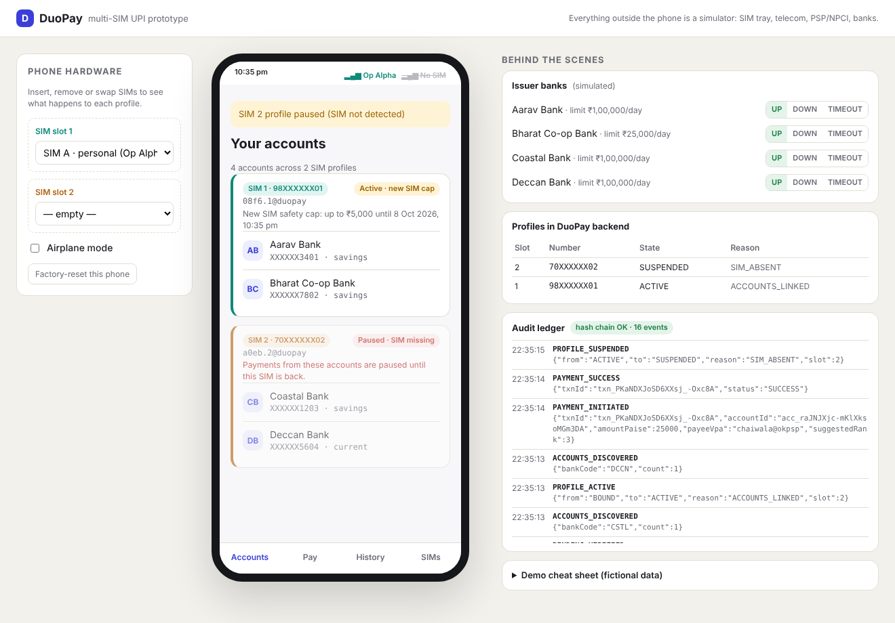

# DuoPay: multi-SIM UPI

**One UPI app for every SIM in your phone.** Today a UPI app binds to one mobile number per device, so bank accounts registered with your second SIM's number are unreachable unless you re-register or install another app. DuoPay creates **one UPI profile per active SIM number**, each with its own SMS device binding, and lets you pay from any linked account. An AI advisor suggests which account to use.

> Prototype. The telecom network, PSP, NPCI, issuer banks and the NPCI Common Library are **simulated** behind production-shaped interfaces. All people, numbers and banks are fictional.



## Documents

| Document | What's in it |
|---|---|
| [High-Level Design](docs/hld.md) | Problem, regulatory constraints (NPCI, RBI, DPDP), architecture, sequence diagrams, profile lifecycle, AI design, threat model, deployment |
| [Low-Level Design](docs/lld.md) | Modules, algorithms, signing scheme, state machine, error codes, config, test plan |
| [API spec](docs/api-spec.md) · [Database](docs/database.md) | Every endpoint; DDL, indexes, what is deliberately not stored |
| [Requirements](docs/requirements.md) · [Decisions (ADRs)](docs/decisions.md) · [Roadmap](docs/roadmap.md) | Functional and compliance requirements; 10 ADRs; next versions |
| [Security review](docs/security-review.md) | Independent review findings and how each was fixed |
| [Architecture overview](docs/architecture.md) | One-page summary |

## Run it

Requires **Node.js 22.5+**. There's nothing to install: the project has zero npm dependencies.

```bash
npm start        # http://127.0.0.1:3000
npm run demo     # same, with the NPCI status-check gap shortened to 10 s for live demos
npm test         # 54 tests
npm run lint:sec # security lint
npm run reset    # wipe local data
```

Optional: set `ANTHROPIC_API_KEY` (and `CLAUDE_MODEL`) in `.env` to have Claude rank the accounts. Without it, the deterministic rules ranking is used.

## 3-minute demo script

1. **Agree to the consent screen.** On the SIMs tab, verify SIM 1 and SIM 2. Each sends its own SMS token from its own slot. Link Aarav and Bharat banks to SIM 1, and Coastal and Deccan to SIM 2. The Accounts tab now shows four banks across two numbers.
2. **Pay ₹250 to `chaiwala@okpsp`.** The suggestion panel ranks all four accounts. Choose a SIM 2 account; the PIN is entered on the NPCI CL sheet (cheat sheet: PINs 1111–4444).
3. **Pull SIM 2** in the *Phone hardware* panel. Only SIM 2's profile is paused, and its accounts show "SIM missing". SIM 1 keeps working. Put it back and it reactivates with a ₹5,000 safety cap.
4. **Swap in SIM C** in slot 2. The SIM 2 profile is deregistered and must be re-verified.
5. **Set Coastal Bank to TIMEOUT** and pay. The payment goes PENDING and is never retried. Status checks are paced, as NPCI requires.
6. **Watch the audit ledger** on the right. Every event is hash-chained (keyed), with no PII.

## How it stays compliant (short version)

- **Each profile is an ordinary UPI registration.** NPCI and banks see nothing unusual; the multi-SIM grouping lives only in DuoPay (ADR-002).
- **SIM state is signed into every request.** A missing SIM suspends only its profile, and a different SIM deregisters it (ADR-006).
- **Per-profile signing keys.** SIM 1 can't authorise a debit from SIM 2's accounts (ADR-007).
- **Device binding per SIM.** Tokens of 35+ characters, 45 s expiry, 3 attempts per slot, device and number, random VMN, same token from two numbers rejected.
- **NPCI rules.** Accounts are listed only during onboarding, with a quota shared by both profiles; balances are never stored; `ReqPay` is never retried.
- **Data handling.** The PIN is captured only by the CL. Numbers are encrypted at rest. VPAs never contain the number.
- **The AI only orders accounts that the rules already allowed.** It gets no PII and no balances, its output is validated, and it falls back to rules (ADR-005).

## Built with Claude Code

`.claude/` holds the AI-native engineering workflow used to build and review this repo:

| Path | Purpose |
|---|---|
| `.claude/CLAUDE.md` | Project brief, non-negotiables, commands |
| `.claude/rules/` | Architecture, coding standards, testing, security, database, API and git rules |
| `.claude/commands/` | `/plan` → `/architecture` → `/implement` → `/test` → `/review` → `/security-review` → `/pr` |
| `.claude/agents/` | planner, architect, developer, tester, reviewer and security-reviewer sub-agents |
| `.claude/settings.json` | Permissions (no `npm install`, no reading `.env`) and a hook that runs the security lint after every edit |

## Project layout

```
src/app.js            composition root, routes          src/modules/      bindings, profiles, simIntegrity, accounts,
src/http/             auth (signatures), errors                           limits, risk, advisor, payments, audit
src/adapters/psp.js   the PSP boundary                  src/simulators/   telecom, PSP/NPCI/banks, fictional world
src/ai/claude.js      Claude client (forced tool call)  public/           phone + app UI, NPCI CL, ops console
src/db/schema.sql     schema                            test/             54 node:test tests
```
