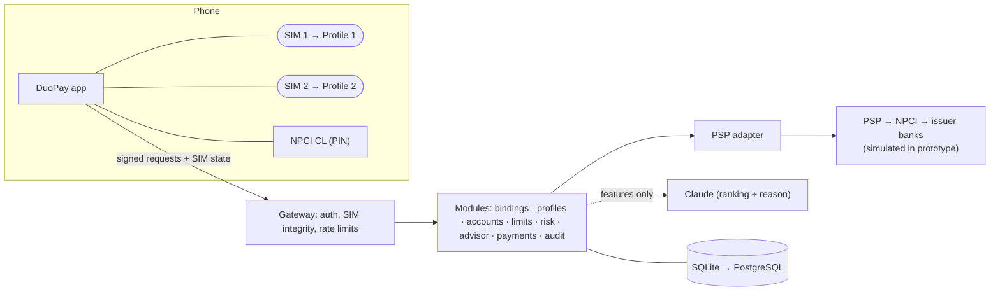

# DuoPay: Architecture overview

This is the one-page summary. The full design is in **[hld.md](hld.md)** (high level, with diagrams) and **[lld.md](lld.md)** (low level), with **[api-spec.md](api-spec.md)** and **[database.md](database.md)** as the contracts.

## In one picture

## Key ideas
1. **One profile per active SIM number.** Each profile is an ordinary, independent UPI registration (its own binding, VPA, key and accounts). Grouping happens only inside DuoPay. (ADR-002)
2. **The SIM gates every action.** The SIM state is signed into every request and checked before any business logic. A missing SIM suspends only its own profile. (ADR-006)
3. **The owning profile signs every payment.** The account's own profile key must sign the payment, so one SIM can't spend another SIM's accounts. (ADR-007)
4. **Rules decide, AI ranks.** Eligibility, limits and risk are code. Claude only orders the eligible accounts and explains, and never sees balances or PII. (ADR-005)
5. **Simulators behind adapters.** Telecom, PSP, NPCI, banks and the CL are simulated behind the interfaces a real integration would use. (ADR-003)

## Code map
| Path | Contents |
|---|---|
| `src/http/` | Router, signature auth, SIM-state header, error mapping |
| `src/modules/` | Business logic (one file per LLD §4 module) |
| `src/adapters/psp.js` | The PSP boundary |
| `src/simulators/` | Fictional telecom, PSP/NPCI/banks, keys and world data |
| `src/ai/claude.js` | Claude client (forced tool call) |
| `public/` | Phone simulator, DuoPay app UI, NPCI CL, ops console |
| `test/` | node:test suites |
