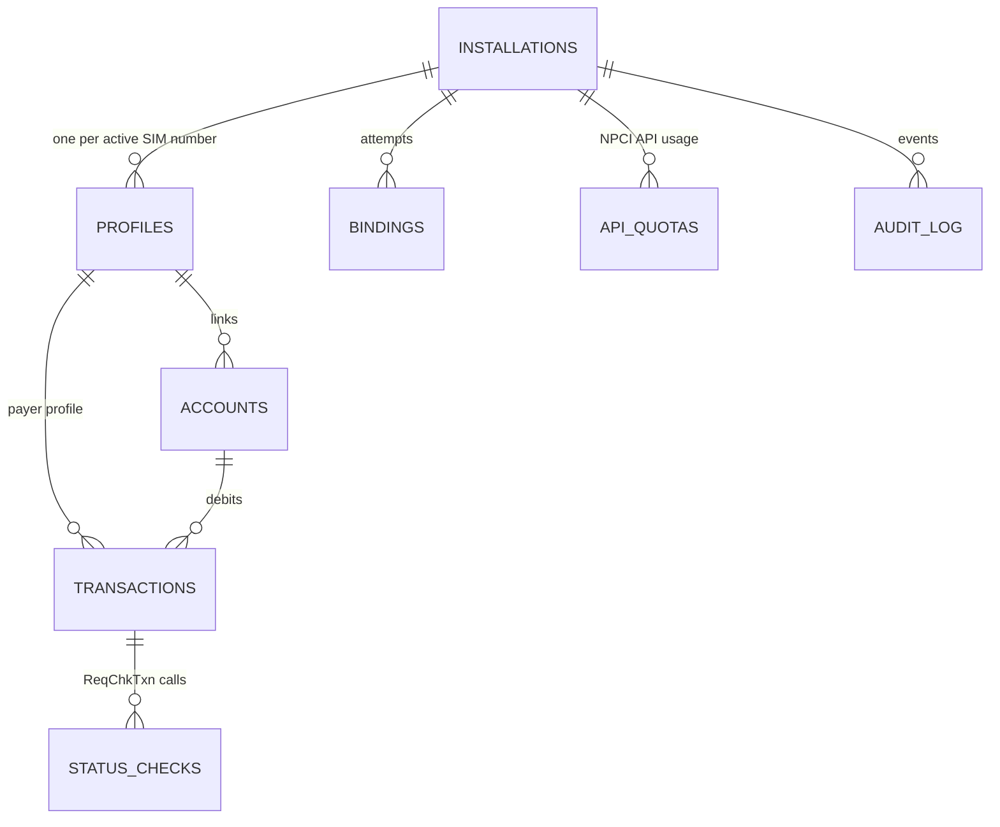

# DuoPay: Database design

The prototype uses SQLite through the built-in `node:sqlite`. The DDL is written to port directly to PostgreSQL for production (HLD §13). The source of truth is [`src/db/schema.sql`](../src/db/schema.sql).

## Entity relationships

## Tables

| Table | Purpose | Key constraints |
|---|---|---|
| `installations` | One app install on one device: device public key, SIM salt, consent | PK `id` |
| `profiles` | **One per SIM number**: slot, encrypted number, bound SIM fingerprint, profile key, VPA, state | Partial unique indexes on live rows: one per `msisdn_hash` (system-wide), one per `vpa`, one per `(installation_id, slot)` |
| `bindings` | Device-binding attempts; only the token hash is stored; slot carrier for the ADR-010 check | `token_hash` unique; index for the 3-per-24h check |
| `accounts` | Linked bank accounts (masked), owned by exactly one profile | Unique `(profile_id, bank_code, account_ref)` |
| `transactions` | Payments; the id is the UPI transaction id | Unique `(installation_id, idempotency_key)`; `amount_paise > 0` |
| `status_checks` | Every `ReqChkTxn`, to enforce NPCI pacing | FK to transaction |
| `api_quotas` | Per-installation, per-day counters for NPCI-limited APIs | PK `(installation_id, api, day)` |
| `request_nonces` | Replay protection for signed requests | PK `nonce`; purged after 10 minutes |
| `audit_log` | Append-only, hash-chained event ledger | `seq` autoincrement; `hash` chains to `prev_hash` |

## What is deliberately *not* stored

| Data | Why |
|---|---|
| Account balances | NPCI OC-95: only the bank may retain balance information |
| Account-holder names | Not needed (ADR-004 removed the same-owner check); data minimisation under DPDP |
| UPI PIN or the encrypted credential block | Captured by the NPCI CL; passed through once and never persisted or logged |
| Binding SMS token | Only its SHA-256 is stored |
| Raw ICCID | Only a salted fingerprint computed on the device |
| Full mobile number in clear | AES-256-GCM ciphertext + keyed hash + masked display form |

## Concurrency and integrity

- Each request's writes, including the nonce insert and the audit append, run in **one transaction** (`BEGIN IMMEDIATE` in SQLite; `SERIALIZABLE` or row locks in PostgreSQL).
- Limit checks read the day's SUCCESS + PENDING totals inside the same transaction that inserts the new `INITIATED` row. Two parallel payments therefore can't both pass a limit with headroom for only one.
- The partial unique indexes make "one live profile per number" a database guarantee, not just application logic.

## Retention (configurable)

| Data | Default retention |
|---|---|
| `transactions`, `status_checks`, `audit_log` | 10 years (regulatory record) |
| `bindings` | 180 days |
| `request_nonces` | 10 minutes |
| `api_quotas` | 30 days |
| Deregistered `profiles` | Number ciphertext erased after 180 days; hash kept for fraud linkage |

## Production notes

- PostgreSQL, partitioned by month on `transactions` and `audit_log`, with India-region primary and DR (RBI data localisation).
- Move `api_quotas`, `request_nonces` and idempotency lookups to Redis with TTLs.
- `DATA_KEY` in a KMS/HSM with envelope encryption and yearly rotation (store a `key_version` column with each ciphertext).
