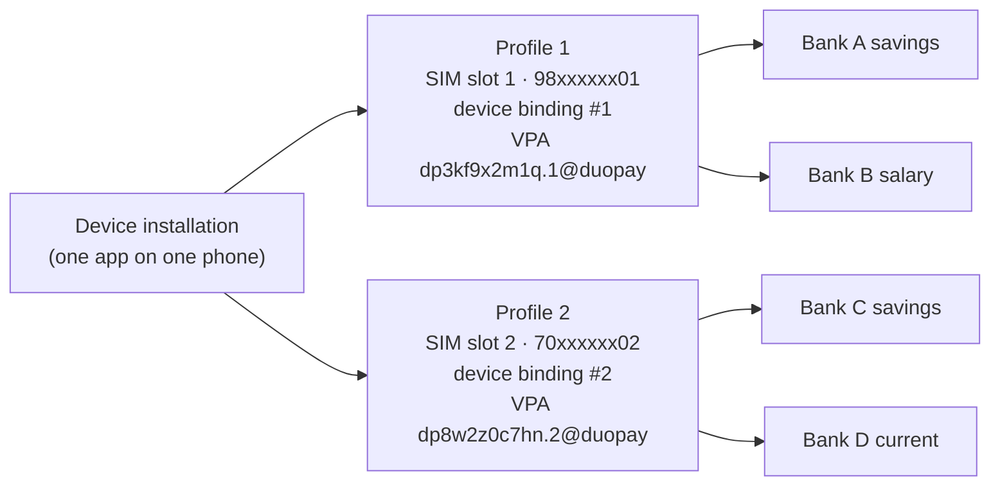
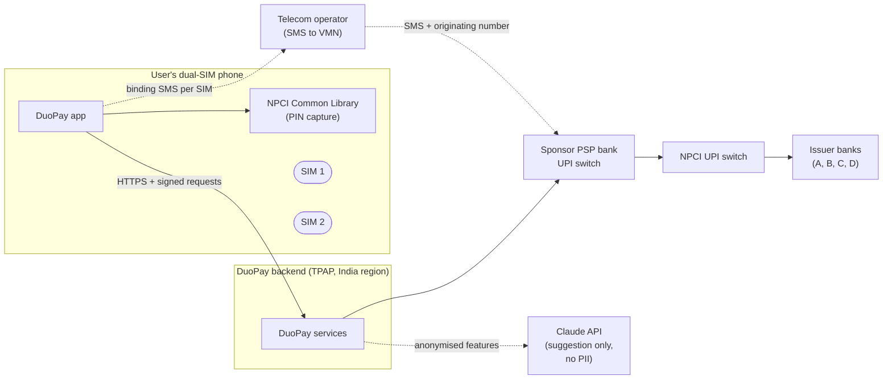
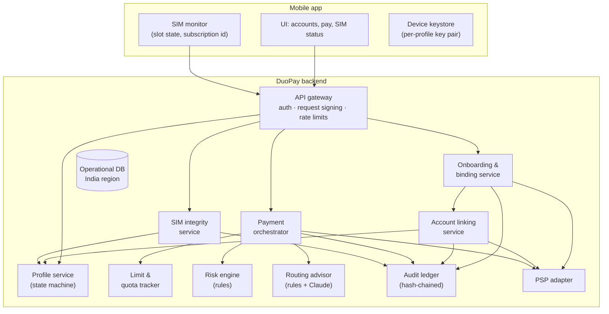
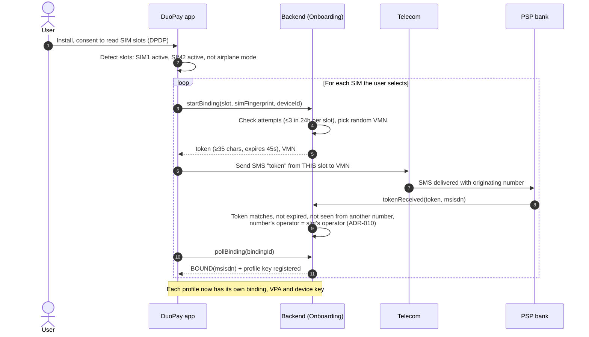
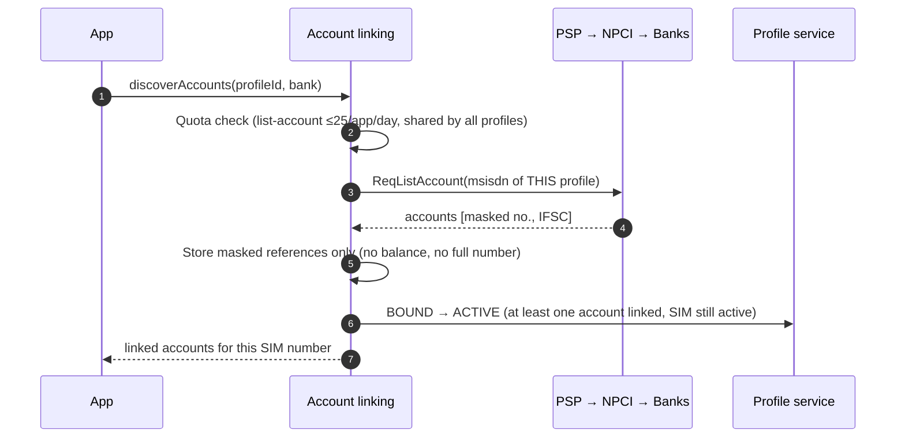
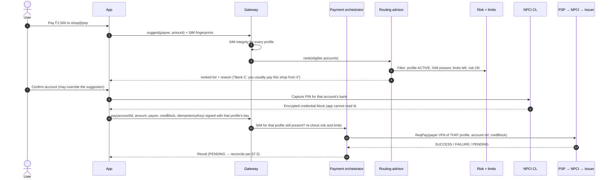
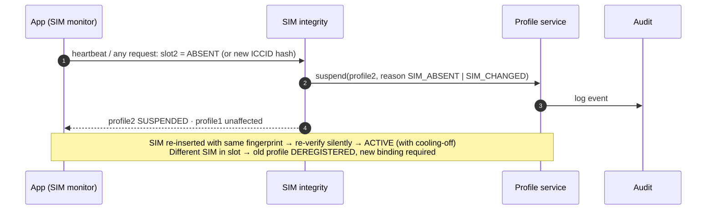
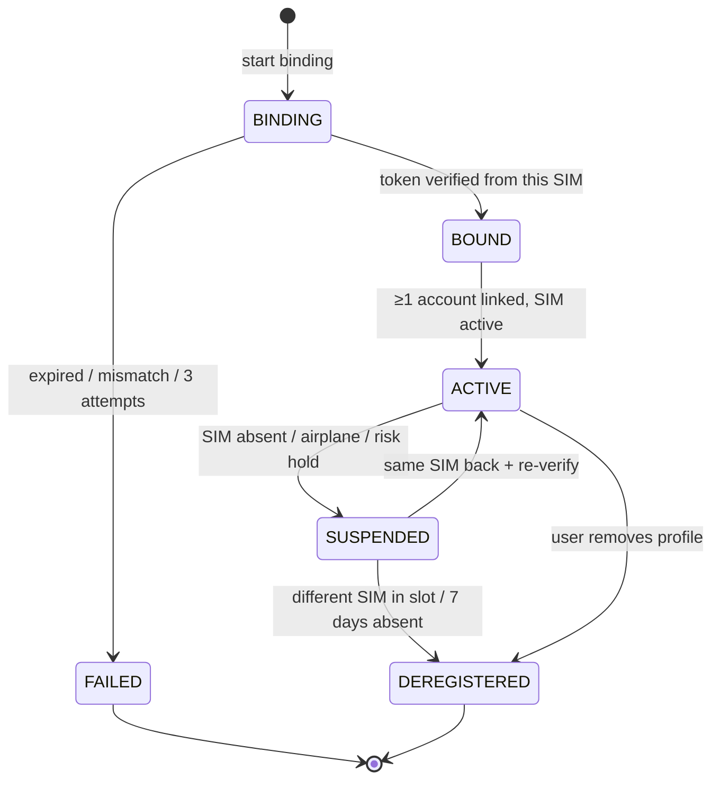
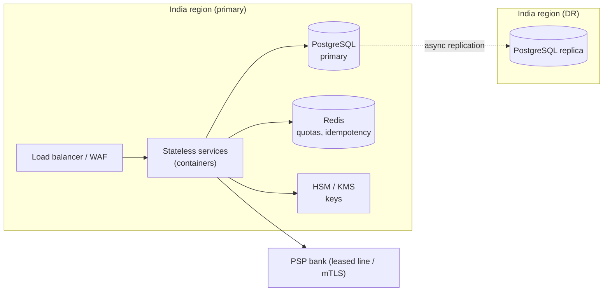

# DuoPay: High-Level Design (HLD)

**A multi-SIM UPI app that creates one UPI profile per active SIM number and lets the user pay from every bank account linked to any of them.**

| | |
|---|---|
| Document | High-Level Design, v1.0 |
| Status | Draft for review |
| Related | [LLD](lld.md) · [API spec](api-spec.md) · [Database](database.md) · [Decisions](decisions.md) · [Requirements](requirements.md) |

---

## 1. Problem

Dual-SIM phones are now the norm in India. Many people keep two numbers, for example a personal number and an older number still registered with a salary or home-town bank. UPI apps bind to **one** mobile number per device. The user chooses one SIM at sign-up and sees only the bank accounts registered with that number. To pay from an account registered with the other SIM, they must:

- re-register the app on the other SIM, which unbinds the first, or
- install a second UPI app, or clone the app with the phone's "dual apps" feature (most UPI apps block cloned installs).

**DuoPay** lets one person bind **both SIMs** in the same app. It shows all their accounts in one list and lets them pay from any of them. Each SIM keeps its own independent, compliant UPI registration.

## 2. Goals and non-goals

**Goals**
- G1. Bind up to one UPI profile per active SIM slot (physical SIM or eSIM), each with its own device binding.
- G2. Discover and link accounts for each bound number, and show them in one unified list.
- G3. Let the user pay from any linked account, choosing it explicitly before entering the UPI PIN.
- G4. Suggest the best account for each payment. The user always makes the final choice.
- G5. Stay at least as strict as single-SIM apps on fraud, SIM-swap and data-protection controls. **Multi-SIM must not open a new fraud channel.**

**Non-goals**
- Merging two numbers into one UPI identity at the NPCI or bank level. Profiles stay separate.
- Pooling money across accounts (sweeps or auto-transfers between accounts).
- iOS in v1. iOS doesn't let apps read SIM-slot details or send SMS silently, so the flow needs a separate design.

## 3. Regulatory constraints that shape the design

| # | Constraint | Source | Effect on design |
|---|---|---|---|
| C1 | Device binding: the app sends an SMS token from the SIM to a PSP virtual mobile number (VMN). The SIM must be active, no binding in airplane mode, the token is ≥35 characters with a 45-second expiry, at most 3 attempts in 24h, 10+ VMNs used at random, and **the PSP declines if the same token arrives from multiple numbers** | NPCI device-binding controls (2023-24) | **Each SIM is bound separately**, with its own token and its own attempt counter. No shared tokens. |
| C2 | The PSP must check that the SIM is active before allowing UPI | NPCI | **SIM integrity is checked per profile** on every sensitive request. |
| C3 | `ReqListAccount` may be used **only** to link accounts during handle creation with device binding | NPCI OC-95 | Account discovery runs only inside onboarding. No background "refresh" of accounts. |
| C4 | Balance information may be started only by the customer and may not be stored by any party other than the bank | NPCI OC-95 | **The AI suggestion never uses balances.** Balances are shown once and not stored. |
| C5 | API rate limits (from 1 Aug 2025): balance enquiry 50/app/day, list account 25/app/day, status check at most 3 in 2h, ≥90s apart | NPCI (Aug 2025) | Rate limiter per user per API. **Two profiles share one per-app budget.** |
| C6 | The UPI PIN is captured only by the NPCI Common Library (CL) and encrypted for the issuer. The app never sees it | UPI spec | PIN entry is delegated to the CL. The backend only passes the encrypted credential block through. |
| C7 | Payment data must be stored only in India | RBI, Storage of Payment System Data (2018) | Single-region deployment in India, with DR also in India. |
| C8 | Consent, purpose limitation and erasure for personal data | DPDP Act 2023 | Explicit consent for each SIM slot read, purpose-tagged data, retention schedule. |
| C9 | The DoT SIM-binding directive (continuous SIM presence) applies to **messaging** apps, not UPI | DoT, Nov 2025 (deadline moved to Dec 2026) | Not mandatory, but we **adopt continuous SIM presence voluntarily** because regulators are moving this way. |
| C10 | A TPAP must operate through a sponsor PSP bank and be NPCI-certified | NPCI | **Multi-profile per device needs NPCI and PSP sign-off** (open item O1). |

> No published NPCI rule explicitly allows or forbids two bound numbers in one app on one device. DuoPay is designed so that each profile is indistinguishable from a normal single-SIM registration to the PSP and NPCI. The multi-SIM grouping lives only in the TPAP layer, with extra controls on top.

## 4. Core concept: one device, one profile per SIM number

- An **Installation** is one DuoPay app on one physical device.
- A **Profile** is created **per SIM number** (MSISDN): one active SIM in one slot of that device. It is equivalent to a normal UPI registration: its own binding, its own VPA, its own linked accounts.
- A profile exists only while its **SIM is active** in the phone. SIMs don't have to belong to the same person (decision ADR-004); each number is verified by its own SMS binding, exactly as in any UPI app.
- A **Linked account** belongs to exactly one profile. A payment from Bank C **must** be sent with Profile 2's binding and SIM identity, never Profile 1's.

This keeps the NPCI and bank view unchanged: each profile is a normal registration. The only new thing is a TPAP-side view that groups the profiles on one device.

## 5. System context

## 6. Component architecture

| Component | Responsibility |
|---|---|
| **API gateway** | Device session authentication, per-profile request signatures, idempotency keys, per-user rate limits (C5) |
| **Onboarding & binding** | Runs the SMS device-binding protocol separately for each SIM slot (C1) |
| **Profile service** | Owns the profile lifecycle state machine (§8). Only this service changes profile state |
| **Account linking** | Calls `ReqListAccount` once per profile during onboarding (C3); stores masked account references |
| **SIM integrity** | Checks the SIM fingerprint the device reports against the bound one; suspends a profile within one request if its SIM is missing or changed |
| **Payment orchestrator** | Validates the payee, enforces the chosen account's profile and SIM, hands off the PIN step, sends `ReqPay`, reconciles pending payments within status-check limits |
| **Limit & quota tracker** | Per-account daily amount and count as seen by DuoPay; cooling-off limits after a new binding; NPCI API quotas |
| **Risk engine** | Deterministic rules: velocity per profile **and per device across profiles**, new payee, cooling period, recent SIM change |
| **Routing advisor** | Ranks *eligible* accounts. Rules decide eligibility; Claude only orders and explains. Has a deterministic fallback |
| **Audit ledger** | Append-only, hash-chained log of every security-relevant event |
| **PSP adapter** | The only component that talks to the sponsor PSP. Maps internal calls to UPI messages |

## 7. Key flows

### 7.1 Onboarding both SIMs (device binding per SIM)

### 7.2 Account discovery

### 7.3 Paying with the account suggestion

### 7.4 SIM removed or swapped

### 7.5 Pending payment reconciliation

A payment returns `PENDING` when the issuer times out. The orchestrator schedules at most **3 status checks within 2 hours, at least 90 seconds apart** (C5). After that it marks the payment `DEEMED_PENDING` and tells the user the bank will settle or reverse it under NPCI dispute timelines. **It never retries `ReqPay`**, because a retry could debit the user twice. Every call carries the same transaction id.

## 8. Profile lifecycle

Payments are allowed **only** in `ACTIVE`. The first 24 hours after any (re)activation run with a **cooling-off cap** (configurable, default ₹5,000), as banks commonly do for new devices.

## 9. Design of the multi-SIM safeguards

### 9.1 Separate profiles
Each profile has its own binding, VPA, device key pair (in the hardware keystore) and limits. A request to pay from an account must be signed with **that account's profile key**, and the profile's SIM must be present. This stops someone from using SIM 1's presence to spend from SIM 2's accounts.

### 9.2 Continuous SIM presence
Every sensitive request carries a fingerprint for each slot: an HMAC of the ICCID or subscription id, salted per device. A fingerprint that is missing or different suspends **only that profile**. The app also sends heartbeats when SIM state changes (Android `ACTION_SIM_STATE_CHANGED` / subscription-change listener).

### 9.3 SIMs are not required to have the same owner (ADR-004)
Each profile is proven only by its own SMS binding from an **active** SIM, exactly as in any single-SIM UPI app. DuoPay does not compare account-holder names across profiles. **Residual risk:** one phone running UPI for several people's numbers is a known mule-account pattern. Compensating controls that don't block legitimate users:
- profiles are capped by the number of active SIM slots (§9.4), so one device cannot host an unlimited number of numbers;
- velocity and amount rules apply **across all profiles on a device**, not just per profile;
- a SIM that changes number in a slot deregisters the old profile and requires a fresh binding plus cooling-off;
- every binding, SIM change and cross-profile pattern is in the audit ledger for the PSP's fraud team.

### 9.4 Profile cap
At most one profile per active SIM slot, and at most 2 per device in v1 (configurable for eSIM devices). Binding attempts count per slot and per device.

## 10. AI design: the routing advisor

| | |
|---|---|
| **Task** | Order the accounts the user is *allowed* to pay from, and give one short reason |
| **Eligibility (rules, not AI)** | Profile `ACTIVE`, its SIM present, remaining daily amount and count, cooling-off cap, bank not in outage, risk OK |
| **Features sent to Claude** | Account alias (e.g. "Bank C ••12"), bank 7-day success rate, remaining daily headroom as a percentage, how often this payee was paid from each account, payee category. **No balances (C4), no names, no phone numbers, no VPAs** |
| **Output** | A forced tool call: `{ranking: [accountRef], reason}` |
| **Guardrails** | The ranking must be a permutation of the eligible list; anything else is discarded. The reason is limited in length and checked for numbers not present in the input |
| **Fallback** | A deterministic weighted score, used when the API is slow (>800 ms budget), fails or is not configured |
| **Authority** | Suggestion only. The user confirms the account before PIN entry. **AI never starts or approves a payment** |

## 11. Threat model (summary)

| Threat | Control |
|---|---|
| SIM swap fraud on one number | Per-profile SIM fingerprint; profile suspended; cooling-off cap after reactivation |
| Pay from SIM 2's account while SIM 2 is absent | Payment requires that profile's key **and** SIM present; checked at the gateway and again in the orchestrator |
| One phone hosting many people's numbers (mule pattern) | Profile cap = active SIM slots; device-level velocity rules; binding attempt limits per device; audit trail (ADR-004 accepts the residual risk) |
| Replayed or shared binding SMS | One-time tokens, 45s expiry, decline the same token from multiple numbers (C1) |
| Token relayed from a SIM in **another** phone (binds a number whose SIM isn't in this slot) | Prototype: the slot's operator (MCC-MNC) must match the number's operator from an MNP lookup. This is client-reported, so it is a weak control. **Production: telco number-verification API at binding (ADR-010, O6)** |
| Bypassing binding limits (fingerprint rotation, re-installs, parallel bindings) | Attempts counted per slot, per device and per number (not per client-supplied fingerprint); one binding in flight per device; cap re-checked at completion |
| Cloned or rooted app | Play Integrity / attestation at binding; key in hardware keystore |
| PIN theft | PIN captured only by the NPCI CL; never in DuoPay memory, logs or backend |
| Double debit on retry | Idempotency keys; never re-send `ReqPay`; status checks only |
| Prompt injection via payee names or notes | Free text is never sent to the AI; only categorical and numeric features |
| Data leakage | Masked account numbers, hashed SIM ids, no balances stored, India-only storage, purpose-tagged retention |
| Insider tampering with logs | Hash-chained audit ledger, verified on read |

## 12. Non-functional requirements

| Area | Target |
|---|---|
| Latency | Suggest p95 < 300 ms with fallback, < 900 ms with AI; pay call dominated by NPCI round trip |
| Availability | 99.95% for the payment path; the advisor is optional and degrades to rules |
| Data residency | All data and logs in India (C7) |
| Audit | Every state change and payment event logged; retention per RBI/NPCI (configurable, default 10 years for transaction records) |
| Privacy | DPDP consent per purpose; data map; erasure of non-regulatory data on account deletion |
| Scale | Stateless services; the ledger and limits tables are partitioned by customer |

## 13. Deployment

**Prototype scope.** The prototype runs as one Node.js process with SQLite. It **simulates** the telecom, PSP, NPCI, issuer banks and NPCI CL behind the same interfaces, so swapping in real adapters does not change the services.

## 14. Open items

| # | Item | Owner |
|---|---|---|
| O1 | NPCI and sponsor-PSP approval for multiple bound profiles per device | Compliance |
| O2 | Whether the per-app API quotas (C5) apply per user or per profile; the design assumes per user, which is stricter | Compliance / PSP |
| O3 | Whether the PSP's fraud team requires a same-owner check despite ADR-004 | Compliance / Risk |
| O4 | iOS feasibility (no SIM-slot APIs, no silent SMS) | Mobile |
| O5 | Cooling-off cap value per bank policy | Risk |
| O6 | Integrate a telco number-verification / SIM-swap API at binding (replaces the client-reported carrier check) | Engineering / PSP |
| O7 | Whether "add another account later" on an ACTIVE profile counts as onboarding under OC-95 (C3) | Compliance |

## Sources

- [NPCI device-binding controls (WeSecureApp)](https://wesecureapp.com/blog/device-binding-to-protect-your-banking-and-upi-apps/)
- [NPCI SIM / device rules (Protectt.ai)](https://protectt.ai/npci-sim-device)
- [NPCI OC-95: Guideline on usage of UPI APIs](https://www.npci.org.in/PDF/npci/upi/circular/2020/OC95-GuidelineonUsageofUPIAPIs.pdf)
- [NPCI API limits from 1 Aug 2025 (Outlook Money)](https://www.outlookmoney.com/banking/npci-tightens-upi-api-rules-from-august-1-after-repeated-outages)
- [UPI non-financial APIs (Oracle docs)](https://docs.oracle.com/en/industries/financial-services/banking-payments/14.8.1.0.0/inuug/psp-upi-switch-non-financial-apis.html)
- [DoT SIM-binding directive (Protectt.ai)](https://protectt.ai/blog/dot-sim-binding-directive-summary) and [deadline extension (MediaNama)](https://www.medianama.com/2026/04/223-dot-sim-binding-deadline-extended-dec-2026/)
- [RBI data localisation (SS Rana)](https://ssrana.in/articles/compliance-data-localization-regulation-in-india/)
- [UPI Circle (AndroBranch)](https://www.androbranch.in/post/carry-two-phones-this-hidden-upi-feature-lets-you-make-payments-from-both-devices-easily)
