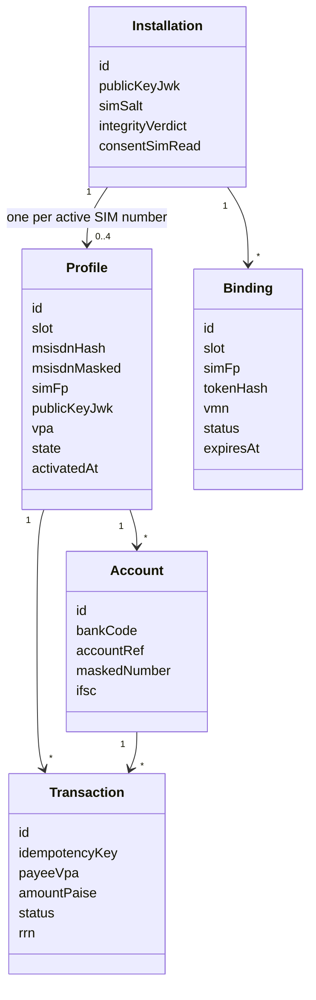
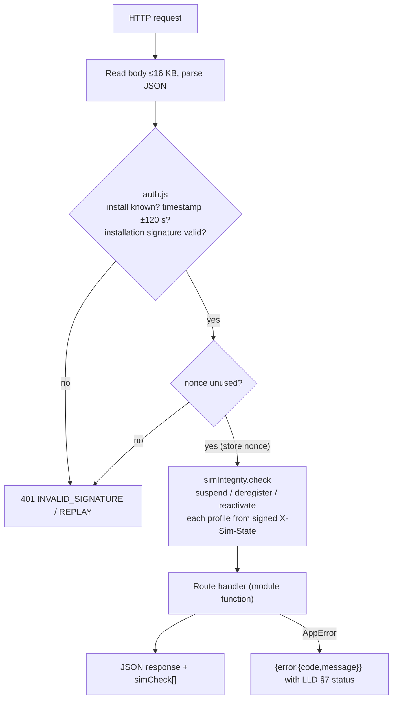
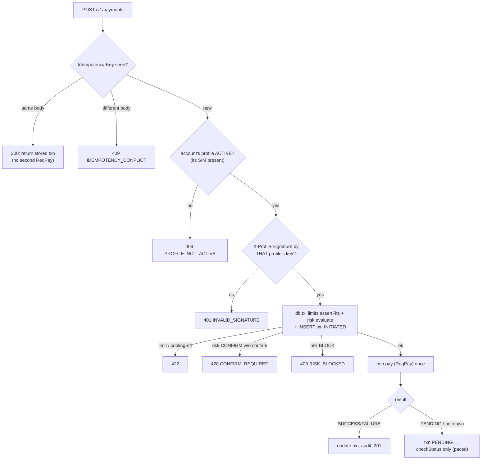

# DuoPay: Low-Level Design (LLD)

| | |
|---|---|
| Document | Low-Level Design, v1.0 |
| Implements | [HLD](hld.md) |
| Companion specs | [API spec](api-spec.md) (every endpoint) · [Database](database.md) (DDL, indexes, retention) |

This LLD describes the prototype as built: Node.js 22, no third-party packages, SQLite through `node:sqlite`, cryptography through `node:crypto` and WebCrypto. Every external party (telecom, PSP, NPCI, issuer banks, NPCI Common Library) is a **simulator behind the same interface a real adapter would implement**.

---

## 1. Code layout

```
src/
  config.js                 env + defaults (limits, timers, feature flags)
  server.js                 starts the HTTP server
  app.js                    composition root: DB, simulators, adapter, route table, static files, error mapping
  http/
    auth.js                 request-signature verification, nonce replay, SIM-state header
    errors.js               AppError + error codes → HTTP status
  db/
    schema.sql              DDL (see database.md)
    index.js                open, migrate, transaction helper
  lib/
    crypto.js               ids, tokens, AES-GCM for MSISDN, HMAC, hashing
    time.js                 IST day boundaries, clock injection for tests
  modules/
    installations.js        register install, consent
    bindings.js             SMS device-binding protocol (per SIM)
    profiles.js             profile state machine (only writer of profiles.state)
    simIntegrity.js         compare reported SIM state with bound fingerprints
    accounts.js             account discovery (ReqListAccount) + linking
    limits.js               per-account daily limits, cooling-off, NPCI API quotas
    risk.js                 deterministic risk rules
    advisor.js              eligibility + scoring + Claude re-ranking
    payments.js             suggest, pay, status check, reconciliation
    audit.js                hash-chained audit ledger
  ai/
    claude.js               Messages API client (forced tool call)
  adapters/
    psp.js                  interface used by modules → simulator today, real PSP later
  simulators/
    world.js                fictional SIM cards, numbers, banks, accounts, PINs, keys
    telecom.js              SMS from a SIM to a VMN (adds originating MSISDN)
    pspSwitch.js            PSP + NPCI + issuer banks (ReqListAccount, ReqValAdd, ReqPay, ReqChkTxn, ListKeys)
public/
  index.html, app.js        phone simulator (2 SIM slots) + DuoPay app UI + ops console
  cl.js                     NPCI Common Library simulator (PIN → RSA-OAEP encrypted block)
test/                       node:test unit + scenario tests
scripts/security-lint.js    banned-pattern lint (also a Claude Code PostToolUse hook)
```

**Dependency rule:** `http → modules → adapters → simulators`. Modules never import simulators directly. `profiles.js` is the only module that writes `profiles.state`.

## 2. Domain model



## 3. Security primitives

### 3.1 Identifiers and tokens (`lib/crypto.js`)
| Item | Generation |
|---|---|
| IDs | `prefix_` + 16 random bytes base64url (`ins_`, `prf_`, `bnd_`, `acc_`, `txn_`) |
| Binding token | 40 characters from `[A-Za-z0-9!#$%*+=?@^_~]` using `crypto.randomInt`, so it is ≥35 characters with a mix of character types (HLD C1). **Only its SHA-256 is stored** |
| MSISDN at rest | `AES-256-GCM(DATA_KEY)` as `iv:tag:ct` (base64url) + `HMAC-SHA256(DATA_KEY, msisdn)` for unique lookups + masked form `98XXXXXX01` |
| SIM fingerprint (device side) | `SHA-256(simSalt + ':' + iccid)`, hex. The salt is issued per installation, so fingerprints can't be linked across installations |
| Audit hash | `HMAC-SHA256(DATA_KEY, prev_hash + '|' + at + '|' + event + '|' + profileId + '|' + data)` |

### 3.2 Request signing (`http/auth.js`)
Each installation and each profile has its own ECDSA P-256 key pair. The private key never leaves the device: a non-extractable WebCrypto key stands in for the Android Keystore.

Canonical string signed by the device:
```
METHOD \n PATH \n X-Timestamp \n X-Nonce \n SHA256(body) \n SHA256(X-Sim-State)
```

| Header | Meaning |
|---|---|
| `X-Install-Id` | Installation id |
| `X-Timestamp` | Unix ms. Rejected if more than ±120 s from server time |
| `X-Nonce` | 16+ random bytes. Stored for 10 minutes; a repeat is rejected with `REPLAY` |
| `X-Sim-State` | base64url JSON `{airplane, slots:[{slot, state:'READY'|'ABSENT', fp, carrier}]}` (`carrier` = the SIM's MCC-MNC). It is covered by the signature, so it can't be swapped in transit |
| `X-Signature` | base64url ECDSA signature (IEEE-P1363) with the **installation** key |
| `X-Profile-Signature` | Same canonical string signed with the **profile** key. Required for payments and profile removal |

Verification order: install exists → timestamp → installation signature → nonce unused → (if required) profile signature with **the key of the profile that owns the account being debited**. The nonce is recorded in its own transaction **before** any business logic runs, so a request that later fails can't be replayed either.

### 3.3 Request pipeline (every signed call)



> **Limitation (documented):** SIM state is reported by the device. In production it is backed by Play Integrity attestation and, where operators offer it, a telco SIM-swap API check at binding and before high-value payments.

## 4. Module designs

### 4.1 `bindings.js`: device binding per SIM

```
startBinding(installationId, {slot, profilePublicKeyJwk}, simState)
  1. simState.airplane == false                        else AIRPLANE_MODE
  2. slot in simState.slots with state READY           else SIM_ABSENT
  3. no live profile in this slot                      else SLOT_ALREADY_BOUND
  4. live profiles on installation < MAX_PROFILES (2)  else PROFILE_CAP
  5. attempts(installation, slot, 24h) < 3 AND attempts(installation, 24h) < 3 × MAX_PROFILES   else BINDING_LIMIT
     (never counted by the client-supplied fingerprint, which an attacker can rotate)
  5a. no other non-expired PENDING binding on this installation                     else BINDING_IN_PROGRESS
  6. token = randomToken(40); vmn = random(VMN_POOL[10])
  7. INSERT bindings(status PENDING, token_hash, carrier = slot's MCC-MNC, expires_at = now + 45s)
  8. audit BINDING_STARTED
  return {bindingId, token, vmn, expiresAt}

onSmsReceived({vmn, text, originMsisdn})        ← called by the PSP adapter
  1. b = binding by sha256(text); none → ignore (log UNKNOWN_TOKEN)
  2. if b.received_msisdn_hash set AND ≠ hmac(originMsisdn) → FAILED TOKEN_MULTI_SOURCE (HLD C1); a profile already created from the first SMS is deregistered
  3. if now > b.expires_at → EXPIRED
  4. if vmn ≠ b.vmn → FAILED VMN_MISMATCH
  4a. if MNP-operator(originMsisdn) ≠ b.carrier → FAILED SIM_NUMBER_MISMATCH   (ADR-010: token relayed from a SIM in another phone)
  4b. if this number already has a live profile on THIS installation → FAILED NUMBER_ALREADY_BOUND_ON_THIS_DEVICE
  4c. if ≥3 bindings received from this number in 24h (any installation) → FAILED BINDING_LIMIT   (survives re-installs)
  4d. re-check: slot still free and live profiles < MAX_PROFILES → else FAILED SLOT_ALREADY_BOUND / PROFILE_CAP
  4e. profile insert hits a constraint → FAILED PROFILE_CONFLICT (fail closed; token consumed)
  5. existing live profile for this msisdn on ANOTHER installation
       → profiles.deregister(old, 'REBOUND_ON_OTHER_DEVICE')  (same as normal UPI device change)
  6. profile = profiles.create({slot, msisdn, simFp, key, vpa}) in state BOUND
  7. b.status = VERIFIED, b.profile_id = profile.id; audit BINDING_VERIFIED

getBinding(id) → {status, profile?}   (expired PENDING is lazily marked EXPIRED)
```

VPA format: `dp<64 random bits in base36>.<slot>@duopay`. It is unique across **all** rows, so a VPA is never reissued, even after deregistration (a recycled VPA could route money to a stranger). It never contains the phone number.

### 4.2 `profiles.js`: state machine

| From | Event | To | Side effects |
|---|---|---|---|
| — | `create` | BOUND | audit |
| BOUND | `accountsLinked(n ≥ 1)` | ACTIVE | `activated_at = now` (cooling-off starts) |
| ACTIVE | `simAbsent` / `airplane` | SUSPENDED | `suspended_at`, reason |
| ACTIVE / SUSPENDED | `simChanged` (different fp in slot) | DEREGISTERED | reason `SIM_CHANGED` |
| SUSPENDED | `simPresent` (same fp) | ACTIVE | `activated_at = now` (cooling-off restarts) |
| SUSPENDED | absent > `SUSPEND_TTL` (7 days) | DEREGISTERED | swept on next touch |
| any live | `remove` (user) | DEREGISTERED | requires profile signature |
| any live | `reboundElsewhere` | DEREGISTERED | |

`transition(profile, event)` rejects anything not in the table with `INVALID_TRANSITION`. It is the only function that issues `UPDATE profiles SET state`.

### 4.3 `simIntegrity.js`

```
check(installationId, simState) → [{profileId, action}]
  for each live profile p of installation:
    s = simState.slots[p.slot]
    if simState.airplane            → action SUSPEND (AIRPLANE)
    elif !s or s.state == ABSENT    → action SUSPEND (SIM_ABSENT)
    elif s.fp != p.sim_fp           → action DEREGISTER (SIM_CHANGED)
    elif p.state == SUSPENDED       → action REACTIVATE
    else                            → OK
  apply actions via profiles.transition; audit each change
```

It runs as **middleware on every signed request**, so the latest SIM state is enforced before any business logic. It also runs on `POST /v1/sim-state`, the heartbeat the app sends on SIM-change broadcasts.

### 4.4 `accounts.js`

```
discover(installationId, profileId, bankCode)
  1. profile BOUND or ACTIVE; this request's signed SIM state shows the profile's slot READY with the bound fingerprint and airplane off
     (SIM integrity doesn't suspend BOUND profiles, so discovery checks this itself)
  2. limits.consumeQuota(installationId, 'LIST_ACCOUNT')   ≤ 25/day per installation (shared by all profiles)
  3. psp.listAccounts({msisdn: decrypt(profile.msisdn_enc), bankCode})   ← ReqListAccount
  4. upsert accounts (masked number, IFSC, type, opaque ref). Holder name and balance are NOT stored
  5. if profile BOUND and ≥1 account → profiles.transition(ACTIVATE)
```

Discovery is allowed only for profiles in `BOUND` or `ACTIVE`, inside the onboarding UI (HLD C3). There is no background refresh.

### 4.5 `limits.js`

| Limit | Default (config) | Scope | Code |
|---|---|---|---|
| Per transaction | ₹1,00,000 | transaction | `LIMIT_EXCEEDED` |
| Daily amount | ₹1,00,000 (overridable per bank) | account, IST calendar day, SUCCESS + PENDING | `LIMIT_EXCEEDED` |
| Daily count | 20 | account | `LIMIT_EXCEEDED` |
| Cooling-off | ₹5,000 total in the first 24h after `activated_at` | profile | `COOLING_OFF_LIMIT` |
| List account | 25/day | installation | `QUOTA_EXCEEDED` |
| Status check | ≤3 per txn within 2h, ≥90 s apart | transaction | `STATUS_CHECK_TOO_SOON` / `STATUS_CHECK_LIMIT` |

`headroom(account)` returns `{amountLeft, countLeft, coolingLeft}`. It is used by both eligibility and the payment check. These figures are **as seen by DuoPay**: the issuer bank enforces its own limits across all apps, and its answer is final.

### 4.6 `risk.js`

```
evaluate({installationId, profile, account, payeeVpa, amountPaise}) → {decision, rules[]}
  R1 DEVICE_VELOCITY  > 5 payments in 5 min across ALL profiles on the installation → BLOCK
  R2 DEVICE_AMOUNT    > ₹2,00,000 in 24h across all profiles on the installation → BLOCK
  R3 NEW_PAYEE_HIGH   first payment to payeeVpa from this installation and amount > ₹20,000 → CONFIRM
  R4 RECENT_REACTIVATION  profile activated < 1h ago and amount > ₹2,000 → CONFIRM
decision = BLOCK if any BLOCK, else CONFIRM if any CONFIRM (client must resend with confirm=true), else ALLOW
```

R1 and R2 are the device-level controls ADR-004 relies on: several SIM numbers on one phone don't multiply the limits.

### 4.7 `advisor.js`: account suggestion

**Step 1, eligibility (rules).** For every account of the installation:
- the profile is `ACTIVE` (after SIM integrity ran);
- `amount ≤ headroom.amountLeft`, `countLeft > 0`, and if in cooling-off `amount ≤ coolingLeft`;
- the bank isn't flagged `DOWN` by the PSP.

Ineligible accounts are returned with a reason (`SIM_ABSENT`, `DAILY_LIMIT`, `COOLING_OFF`, `BANK_DOWN`) so the UI can show why they're greyed out.

**Step 2, features** for each eligible account (no PII, no balances):
```
{ ref: "A1", bank: "Bank C", payeeShare: 0.8, successRate7d: 0.97, headroomPct: 0.62, lastUsedDaysAgo: 2 }
```
- `payeeShare`: the share of past payments to this payee made from this account.
- `successRate7d`: SUCCESS / (SUCCESS + FAILURE) for the bank over 7 days (prior 0.95 when there are fewer than 5 payments).

**Step 3, deterministic score** (always computed):
`score = 0.45·payeeShare + 0.25·successRate7d + 0.20·headroomPct + 0.10·recency`, where `recency = 1/(1+lastUsedDaysAgo)`.

**Step 4, Claude (optional)**, when `ANTHROPIC_API_KEY` is set and there are ≥2 eligible accounts:
- System prompt: rank the eligible accounts for this payment and give one reason of ≤ 90 characters, using only the given features.
- Forced tool `rank_accounts {ranking: string[], reason: string}`, temperature 0, 800 ms timeout.
- **Validation:** `ranking` must be a permutation of the eligible refs, and `reason` must contain no number absent from the features. On failure, timeout or error, use the deterministic order and a template reason (`source: "rules"`).

Response: `{eligible: [...ranked], ineligible: [...], source: "claude"|"rules", reason}`.

### 4.8 `payments.js`

```
suggest(installationId, {payeeVpa, amountPaise})
  psp.validateAddress(payeeVpa)  ← ReqValAdd → payee name or PAYEE_INVALID
  advisor.rank(...)

pay(installationId, {accountId, payeeVpa, amountPaise, credBlock, confirm, suggestedRank}, idempotencyKey, profileSig)
  1. existing = txn by (installationId, idempotencyKey)
       same request_hash → return existing (no second ReqPay)
       different hash   → IDEMPOTENCY_CONFLICT
  2. account → profile; profile.state == ACTIVE else PROFILE_NOT_ACTIVE
  3. verify X-Profile-Signature with profile.public_key_jwk else INVALID_SIGNATURE
  4. limits.check + risk.evaluate (CONFIRM without confirm=true → CONFIRM_REQUIRED)
  5. INSERT txn INITIATED; audit PAYMENT_INITIATED
  6. r = psp.pay({txnId, payerVpa: profile.vpa, accountRef, bankCode, payeeVpa, amount, credBlock})  ← ReqPay
  7. UPDATE txn status = r.status (SUCCESS | FAILURE | PENDING), rrn, failure_code; audit

checkStatus(installationId, txnId)
  only for PENDING; enforce ≤3 checks in 2h and ≥90 s apart
  r = psp.checkTxn(txnId)  ← ReqChkTxn
  after the 3rd PENDING result → DEEMED_PENDING (user told: bank settles or reverses per NPCI TAT)
  NEVER re-sends ReqPay
```



The credential block is opaque to DuoPay. It is passed through to the PSP and is **never logged or stored**.

### 4.9 `audit.js`
`append(event, {installationId, profileId, data})` runs inside the caller's DB transaction: read the last hash, compute the new **HMAC-SHA256 (keyed with `DATA_KEY`)**, insert. The key means someone with DB access alone can't rewrite and re-chain the ledger. `verify()` walks the chain and reports the first broken `seq`. Payloads hold masked values only, enforced by an allow-list of keys per event type.

## 5. NPCI Common Library simulation (`public/cl.js`)
1. The app requests the issuer's public key (`GET /sim/npci/keys?bank=BNKC`, mirroring `ListKeys`).
2. The CL shows its own PIN pad, encrypts `{pin, amountPaise, payeeVpa, nonce, ts}` with RSA-OAEP-256 using the issuer key, and returns a base64 block.
3. The DuoPay app code never handles the PIN variable. The issuer simulator decrypts the block and checks the PIN, that amount and payee match the `ReqPay`, freshness (`ts` within 120 s) and that the nonce is unused. A captured block therefore can't be replayed or reused for a different amount.

## 6. PSP adapter interface (`adapters/psp.js`)

| Method | UPI message it stands for | Returns |
|---|---|---|
| `listAccounts({msisdn, bankCode})` | ReqListAccount | `[{accountRef, maskedNumber, ifsc, type}]` |
| `validateAddress(vpa)` | ReqValAdd | `{valid, name}` |
| `pay({...})` | ReqPay | `{status, rrn?, code?}` |
| `checkTxn(txnId)` | ReqChkTxn | `{status, rrn?}` |
| `bankStatus()` | ListAccPvd (health) | `{BNKA: 'UP', ...}` |
| `onSms(handler)` | inbound binding SMS | — |

## 7. Error codes

| Code | HTTP | Meaning |
|---|---|---|
| `INVALID_SIGNATURE` | 401 | Missing or bad installation/profile signature |
| `REPLAY` | 401 | Nonce reused or timestamp out of window |
| `AIRPLANE_MODE` | 409 | Binding, linking or payment attempted in airplane mode |
| `BINDING_IN_PROGRESS` | 409 | Another SIM's verification is still pending on this device |
| `SIM_ABSENT` | 409 | Required SIM slot is empty or not ready |
| `SIM_CHANGED` | 409 | Different SIM in a bound slot; profile deregistered |
| `SLOT_ALREADY_BOUND` | 409 | Slot already has a live profile |
| `PROFILE_CAP` | 409 | Installation already has the maximum live profiles |
| `BINDING_LIMIT` | 429 | 3 binding attempts in 24h for this SIM |
| `TOKEN_EXPIRED` / `TOKEN_MULTI_SOURCE` / `VMN_MISMATCH` / `SIM_NUMBER_MISMATCH` / `NUMBER_ALREADY_BOUND_ON_THIS_DEVICE` | — | Binding failure reasons, returned as `failReason` by `GET /v1/bindings/{id}` |
| `PROFILE_NOT_ACTIVE` | 409 | Payment from a profile that is not ACTIVE |
| `QUOTA_EXCEEDED` | 429 | NPCI per-app API quota used up |
| `LIMIT_EXCEEDED` / `COOLING_OFF_LIMIT` | 422 | Amount or count limits |
| `CONFIRM_REQUIRED` | 428 | A risk rule needs explicit confirmation |
| `RISK_BLOCKED` | 403 | A risk rule blocked the payment |
| `PAYEE_INVALID` | 422 | VPA failed validation |
| `BANK_DOWN` | 503 | Issuer unavailable |
| `IDEMPOTENCY_CONFLICT` | 409 | Same key, different body |
| `STATUS_CHECK_TOO_SOON` / `STATUS_CHECK_LIMIT` | 429 | NPCI status-check pacing |
| `INVALID_TRANSITION` | 409 | Illegal profile state change |
| `VALIDATION` / `NOT_FOUND` | 400 / 404 | Bad input / unknown resource |

## 8. Configuration (`config.js`, env overrides)

| Key | Default | |
|---|---|---|
| `PORT` | 3000 | |
| `DB_PATH` | `./data/duopay.db` | `:memory:` in tests |
| `DATA_KEY` | generated per run with a warning | 32-byte hex; required in production |
| `MAX_PROFILES` | 2 | per installation |
| `BINDING_TTL_SEC` / `BINDING_MAX_ATTEMPTS` | 45 / 3 | |
| `COOLING_OFF_PAISE` / `COOLING_OFF_HOURS` | 500000 / 24 | |
| `DAILY_LIMIT_PAISE` / `DAILY_COUNT` / `TXN_LIMIT_PAISE` | 10000000 / 20 / 10000000 | |
| `STATUS_CHECK_GAP_SEC` / `STATUS_CHECK_MAX` | 90 / 3 | demo may lower the gap |
| `SUSPEND_TTL_DAYS` | 7 | |
| `ANTHROPIC_API_KEY`, `CLAUDE_MODEL`, `ADVISOR_TIMEOUT_MS` | —, `claude-haiku-4-5`, 800 | the advisor needs low latency, so a small model by default |
| `ENABLE_SIMULATORS` | true in dev; **forced false when `NODE_ENV=production`** | `/sim/*` and `/ops/*` routes |

## 9. Test plan (maps to `test/`)

| Area | Key cases |
|---|---|
| Binding | Happy path for both slots; SIMs of different owners allowed (ADR-004); airplane mode; absent SIM; 4th attempt blocked; expired token; same token from two numbers; token relayed from another phone (ADR-010); number rebound on another device deregisters the old profile |
| SIM integrity | Remove SIM 2 → only profile 2 suspended; re-insert → active with cooling-off; different SIM in slot 2 → deregistered |
| Accounts | Quota shared across profiles (25/day); balances and names not stored |
| Payments | Pay from each profile; pay from SIM 2's account with SIM 2 absent → rejected; profile signature from the wrong profile → rejected; idempotent replay returns the same txn without a second debit; conflicting replay; PENDING → status-check pacing → DEEMED_PENDING |
| Limits / risk | Cooling-off cap; daily limit; device velocity across profiles; new-payee confirm |
| Advisor | Ineligible reasons; deterministic ranking; a Claude response with a foreign ref or invented number falls back to rules; timeout falls back |
| Security | Bad signature, replayed nonce, tampered SIM-state header, PIN never in logs or DB, audit chain detects tampering |
